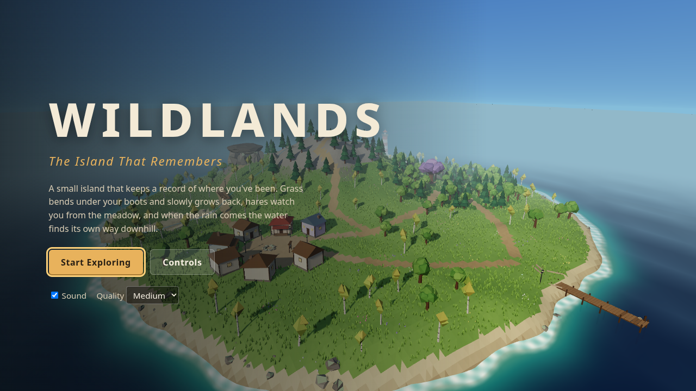
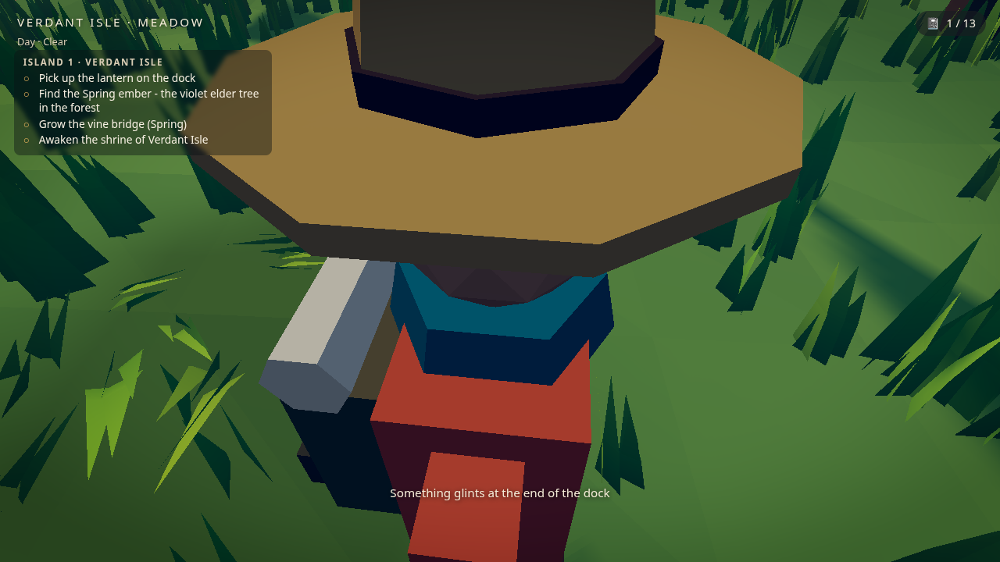
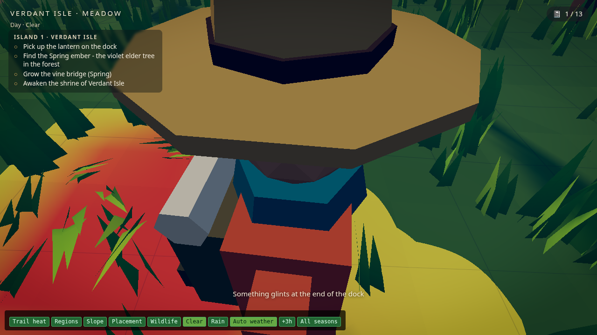
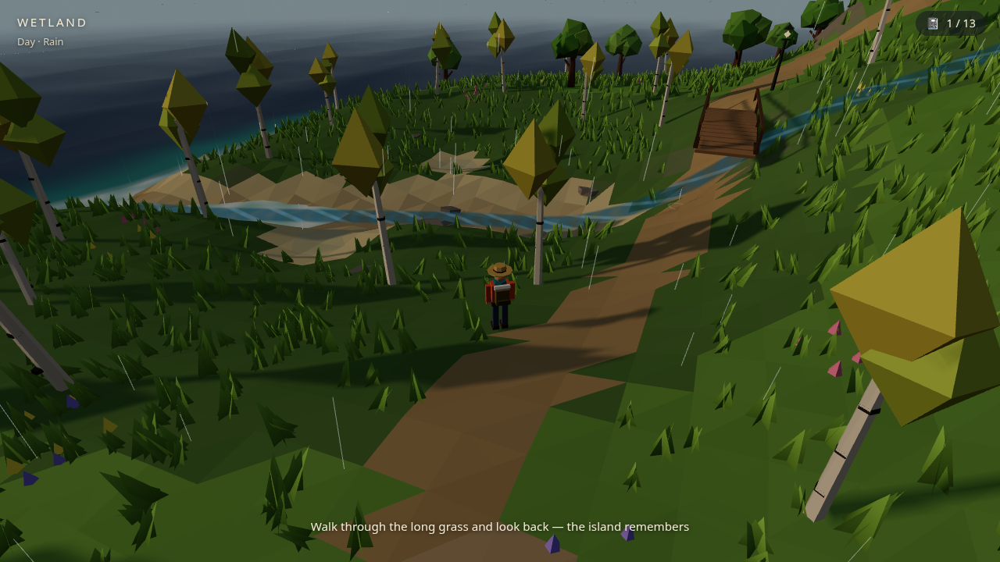
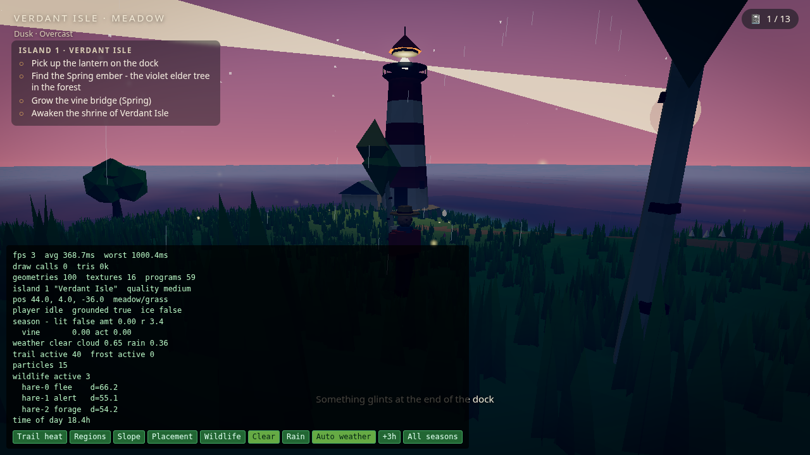
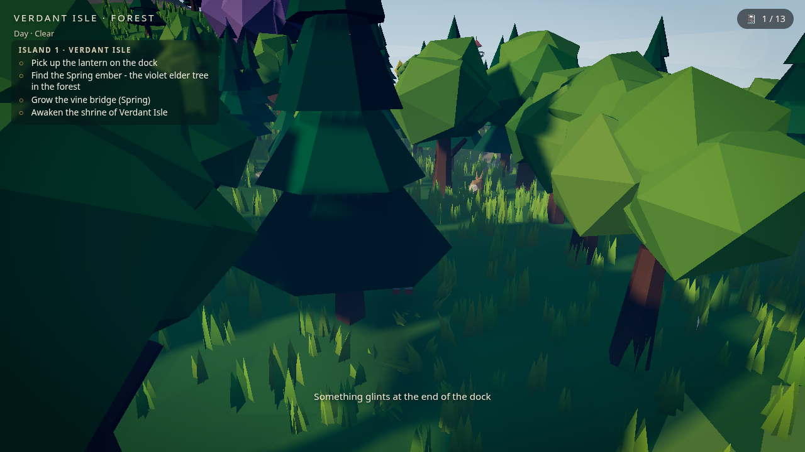
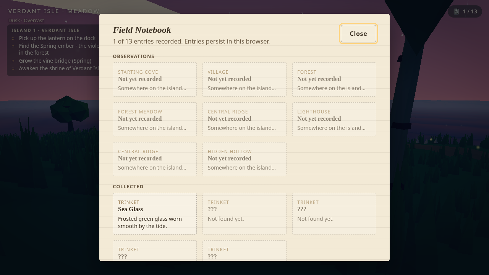

# WILDLANDS: The Island That Remembers

A third-person, low-poly exploration game built with Three.js. The island keeps
a record of where you've walked: grass flattens into a trail behind you and
slowly grows back, hares notice you and bolt, and when it rains the water runs
down the ridge into the stream and fills the wetland pools, which then dry out.



**Play it:** https://wildlands-threejs.vercel.app

## What's in it

- **Seeded procedural island** (~160 m across) with a cove, a village, a forest, a central ridge,
  a wetland and stream, a lighthouse point and a hidden hollow. The same seed always gives the
  same island. Try `?seed=anything`.
- **Persistent footsteps.** Walking through grass flattens it, sand keeps faint tracks, rock doesn't
  change at all. Trails fade over a minute or two and are saved with your progress.
- **Wildlife with a real state machine.** Hares forage, notice you, watch you, flee, and come back
  home once it's quiet. Running makes you easier to hear.
- **Weather and water.** Clear, cloudy and rain cycle on their own. Rain feeds runoff channels
  traced downhill from the ridge, swells the stream, fills the pools and wets the low ground,
  and everything dries again afterwards.
- **Shaders.** A custom ocean (waves, depth colour baked from the terrain, foam at the waterline,
  sun glint), a flow shader for the stream and runoff, wind and trampling in the grass, and a
  terrain shader for the trail, wetness and debug views.
- **Day and night.** The sun moves, the sky changes colour, stars come out, village lamps glow and
  the lighthouse beam sweeps the sea after dark.
- **Field notebook.** 8 discoveries and 5 collectible trinkets, all saved locally (versioned,
  validated, and you can reset it).
- **Original assets only.** Every model is built in code from primitives (explorer, hares,
  trees, rocks, houses, dock, bridge, lighthouse, cave) and every sound is synthesised with
  Web Audio. Nothing is downloaded.

| | |
| --- | --- |
|  |  |
| Walking back and forth in the meadow | The same trail in the trail-heat debug view |
|  |  |
| Rain: the stream swells and the pools fill | Dusk at the lighthouse, with the diagnostics panel open |
|  |  |
| Hares watching the player approach | The field notebook |

## Controls

| Input | Action |
| --- | --- |
| W A S D / arrow keys | Move (relative to the camera) |
| Shift | Run |
| Space | Jump |
| E | Interact / pick up |
| Mouse | Click the view to capture the mouse and look around (or drag). Wheel zooms. |
| N or Tab | Field notebook |
| Esc | Pause, which also releases the mouse |
| `` ` `` or F3 | Developer diagnostics |

The pause menu has volume sliders (master, ambience, effects), mute, quality, mouse
sensitivity, invert-Y, reduced motion, reset progress and exit to title.
The game is built for keyboard and mouse. Touch devices get a notice saying so instead
of keyboard instructions they can't use.

## Running it

```bash
npm install
npm run dev        # http://localhost:5173
npm run build      # production build in dist/
npm run preview    # serve the build
npm test           # unit tests (Vitest)
npm run smoke      # headless browser smoke test against dist/ (needs Chrome/Chromium)
npm run measure    # renderer counters per quality preset
```

URL options: `?seed=<text>` picks the island, `?quality=low|medium|high` forces a preset,
`?debug` opens diagnostics on load.

Deploying: `vercel.json` sets up a plain Vite static build (`npm run build`, output `dist`).
No environment variables or secrets are needed.

## How it works

```
src/
  core/         Game (lifecycle, fixed-step loop, modes), input
  procedural/   seeded random, noise, island layout, terrain + queries, placement rules,
                tree / rock / building generators, geometry helpers
  world/        terrain mesh + material patch, ocean, sky + day/night, prop assembly
  player/       explorer model, character controller, collision world, follow camera
  simulation/   trail grid, grass, weather, runoff tracing, water visuals, rain, hares + brain
  interaction/  interactable registry, discovery text, collectibles
  systems/      audio, save/load, quality presets, diagnostics
  ui/           HTML overlay (title, HUD, notebook, pause, cards) and styles
  shaders/      ocean and flow GLSL
tests/          Vitest unit tests, Playwright smoke test and measurement script
```

### One terrain, one set of queries

`generateTerrain()` evaluates the height function once into a 180x180 grid. Everything else
reads the grid through `heightAt(x, z)`, which interpolates with **the same triangle split as
the render mesh**, so the player, hares, props and water sit exactly on the surface you see.
`normalAt`, `slopeAt`, `isLandAt`, `regionAt` and `groundTypeAt` are built on top of it and
used by placement, movement, trails and audio alike.

Landmark positions come from a small hand-authored layout (with a seeded nudge), because "where
is the village" is a design decision. The detail around them is procedural. The coastline
is a radial mask whose radius is perturbed by noise sampled *on a circle* (no seam at ±180°),
plus a headland for the lighthouse and a bay for the cove. The village terrace, the wetland
basin, the pools and the cave ledge are shaped on top. The stream bed is sampled along its
course and clamped to be non-increasing, so it can't run uphill.

Placement is rule-based and returns plain data: trees need land, modest slope, distance from
paths, the stream and the keep-out zones around landmarks, and minimum spacing (via a spatial
hash). The rules change by region (dense mixed forest, sparse pines on the ridge, birches in the
meadow). The vegetation seed is separate, so you can replant without reshaping the terrain.
Tests check that the same seed gives identical output.

### The trail system

`TrailGrid` is a 320x320 grid of disturbance values over the island (0.75 m cells).

- Moving stamps a small disc proportional to distance travelled. Standing still adds nothing,
  and a teleport doesn't draw a line across the map.
- Each surface responds differently: grass gains fully and recovers in about 90 s, sand gains about
  half and recovers faster, rock and water don't change.
- Only disturbed cells are kept in an *active list*. Regrowth walks that list round-robin with a
  fixed per-frame budget, and scales each visit by how long it's been since the last one, so the
  recovery rate doesn't depend on the budget or the frame rate.
- Rendering only reads the data: the grid is copied into a small texture the terrain shader uses
  to darken the ground, and into a per-instance attribute that flattens and bends the nearby
  grass clumps. Nothing is created per footprint.
- The grid is stored in the save as a run-length encoded string, so trails survive a reload.

### Hares

`WildlifeBrain` is a pure state machine (`forage -> notice -> alert -> flee -> return -> forage`)
with explicit distance and timer conditions. It runs on a fixed 20 Hz tick, which tests confirm
gives the same decisions as 60 Hz. Steering is a limited turn rate towards the brain's target,
and every step is checked against the terrain (no water, cliffs or stream) and the collision
world, with sideways slides before giving up. Flee targets are clamped to the habitat disc, so
hares never leave their meadow or head for the sea. The diagnostics overlay draws the detection
rings, habitat and current target.

### Weather and water

`WeatherSim` is a handful of smoothed values: cloud, rain, runoff, pool level and wetness, all
driven by a seeded clear/cloudy/rain cycle. Runoff routes are traced at load time by
steepest descent from points around the summit until they hit the stream, a pool, the sea or a
local minimum, so they always follow the real terrain downhill. The channels and stream are
ribbon meshes with a flow shader whose highlights scroll downhill at a speed tied to runoff.
Pools are discs that rise and spread with the pool level, and the terrain shader darkens low
ground in proportion to wetness. It's deliberately a stylised model, not a fluid solver.

### Character and camera

The controller runs on a fixed 60 Hz step with a capped frame delta. Horizontal motion is
relative to camera yaw and eases in and out. Vertical motion (gravity, jumping, landing) is separate
from ground snapping, so you aren't glued to the terrain mid-air. Collision uses a circle proxy
against circles (trunks, rocks, tower) and rotated boxes (houses, boards) in a spatial hash. The
dock and the bridge are walkable decks with their own height function (the bridge arches). Steep
slopes and deep water push you back. The follow camera raycasts from the head to pull itself in
front of obstacles and never drops below the terrain.

### Saves

`localStorage`, versioned (`v2`, with a migration from `v1`). The save holds the seed and a
config fingerprint, discoveries, collected items, settings, player position, time of day and
the compacted trail. Each field is validated separately. Progress from a different world
config is dropped but settings are kept, and corrupt JSON is ignored instead of blocking
startup. Reset Progress is in the pause menu.

### Diagnostics

Open with `?debug`, `` ` `` or F3: FPS, average and worst frame time, draw calls, triangles,
geometries, textures, shader programs, seed, position, region and surface, player state,
weather values, active trail cells and each hare's state and distance. Buttons switch the
terrain to trail-heat / region / slope views (with the grid drawn), show all placement points,
show the wildlife overlay, force the weather, skip time, and speed up regrowth.

## Testing

- `npm test` runs 44 unit tests: seeded RNG and noise, identical terrain and placement for the
  same seed, vegetation-seed independence, placement rules (land, slope, path clearance,
  spacing, house orientation), terrain queries (exact at vertices, continuous, unit normals,
  footprint size, regions), the stream bed and runoff routes never running uphill, save
  validation and migration, the trail grid (surface response, standing still, recovery,
  per-frame budget, serialisation), weather transitions and drying, wildlife state transitions
  and tick-rate independence, and collision resolution.
- `npm run smoke` builds nothing itself. It serves `dist/` (or tests a deployed build when `BASE_URL` is set), drives the game in headless Chrome and
  checks: title loads without console errors, Start enters play, movement, jump and landing,
  collectible prompt and pickup, trail creation, the hares reacting, rain producing runoff and
  pools, diagnostics, the notebook, the save surviving a reload, a corrupt save being ignored,
  and the title working at 390 px wide. It also captures the screenshots in `docs/screenshots/`.

## Known limitations

- Tested in headless Chrome with software WebGL only. Real-GPU performance is still to be
  measured (see [PERFORMANCE.md](PERFORMANCE.md)).
- There are no touch controls. Mobile players get a clear notice instead.
- The cave is a hollow built from rock and roofed over, open to the south, not a long tunnel.
- The water is a stylised cause-and-effect model: a few traced channels, a stream and three
  pools, not a fluid simulation.
- MSAA can only change on reload. The other quality settings apply immediately.
- Hares avoid solids by checking steps and sliding sideways, not by pathfinding, so in a dense
  thicket they can stall briefly before picking a new spot.

## Credits

Code, models and sounds by Jeremy Teddy Ndeda. Built on [three.js](https://threejs.org/) (MIT)
and [Vite](https://vitejs.dev/). Audio details are in [AUDIO_CREDITS.md](AUDIO_CREDITS.md).
Released under the MIT license.
