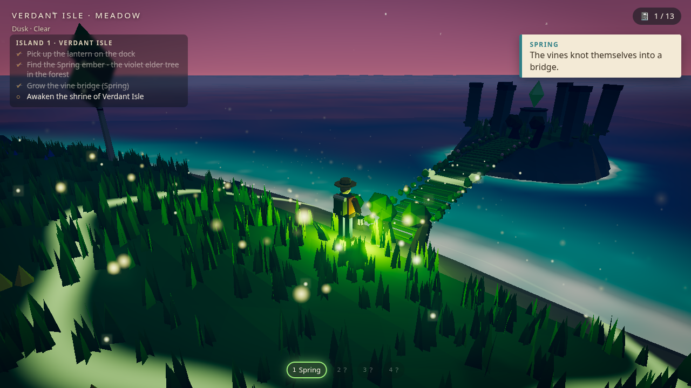
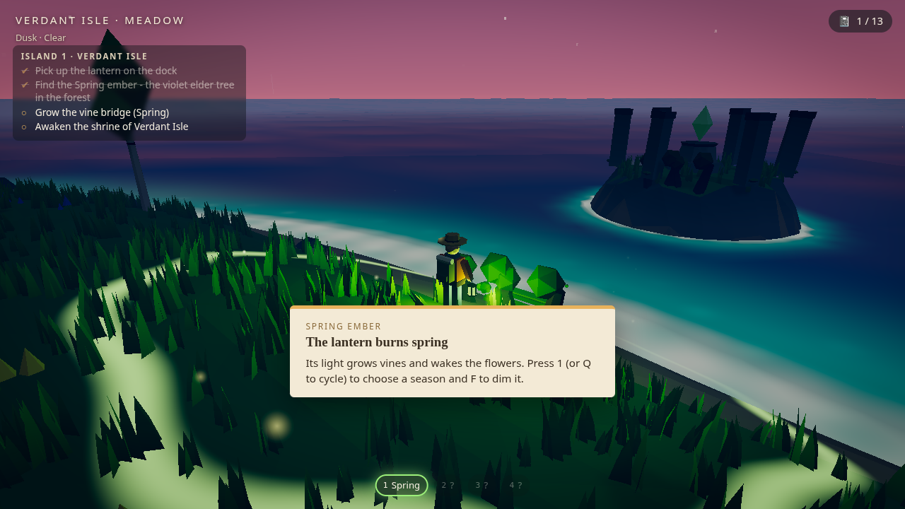
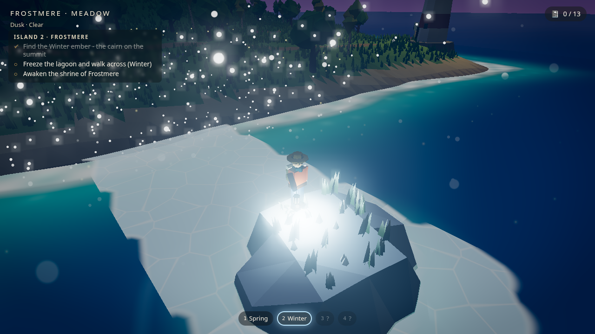
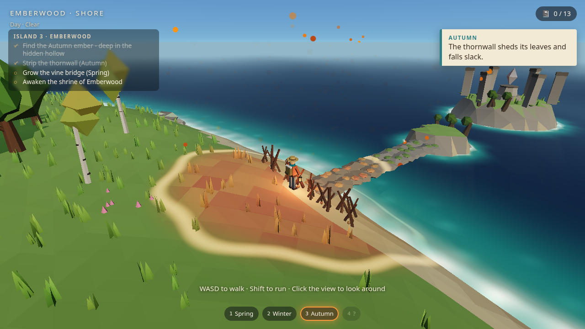
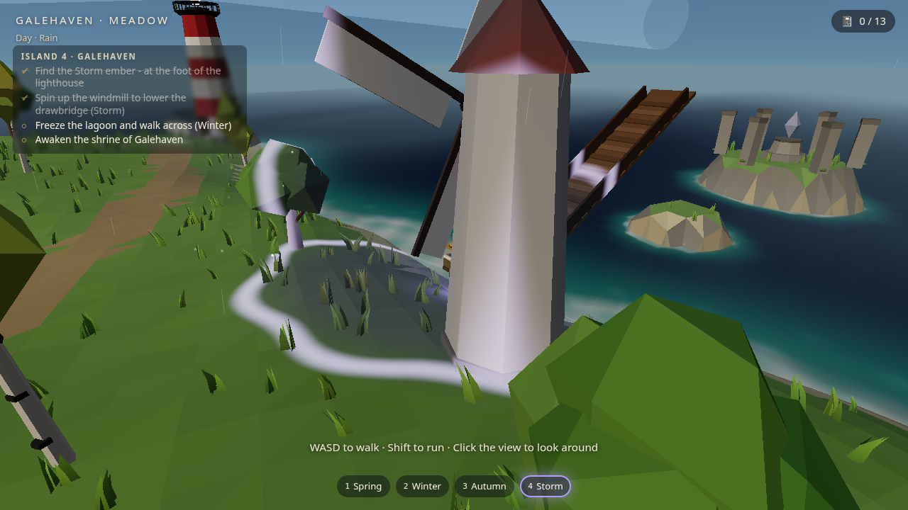
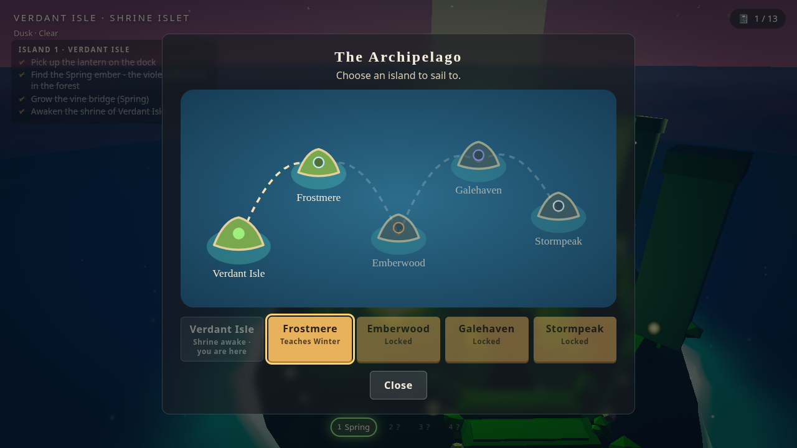
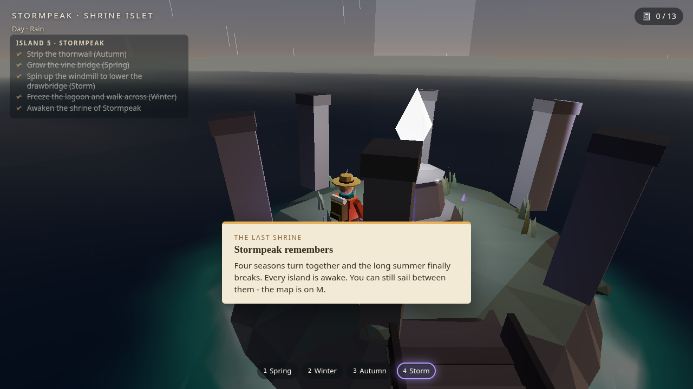

# WILDLANDS: Seasonkeeper

A third-person, low-poly exploration and puzzle game built with Three.js. Five islands are stuck
in the same endless summer. You carry an old lantern, and wherever its light falls the world
shifts into another season: spring grows bridges out of vines, winter freezes the lagoon into
ice you can walk on, autumn strips a thornwall bare and storm spins up a windmill that lowers a
drawbridge. Wake each island's shrine and sail on to the next, up to Stormpeak, where you need
all four.

It started as *The Island That Remembers* (v1, still on `main`), a single island where grass
remembers your footsteps, hares react to you and rain runs downhill. All of that is still here
on every island. The lantern sits on top of it.



**Play it:** https://wildlands.jeremyteddy.dev (production is v1; the `v2` branch has its own
Vercel preview).

## The islands

| # | Island | Season you learn | Crossing to the shrine |
| --- | --- | --- | --- |
| 1 | Verdant Isle | Spring (ember by the violet elder tree) | a vine bridge that grows under spring light |
| 2 | Frostmere | Winter (ember at the summit cairn) | two stretches of open water you freeze and walk over |
| 3 | Emberwood | Autumn (ember in the hidden hollow) | a thornwall on the causeway, then a vine bridge |
| 4 | Galehaven | Storm (ember at the lighthouse) | a windmill-driven drawbridge, then ice |
| 5 | Stormpeak | - | thornwall, vines, ice and drawbridge in a row |

Each island has its own objective list in the corner of the screen (find the ember, solve the
crossing, wake the shrine). Waking a shrine unlocks the next island on the archipelago map and
brings a boat to the dock. The usual notebook entries and trinkets are on every island too,
saved separately per island.

| | |
| --- | --- |
|  |  |
| Spring: the field tints everything inside it and wakes the vines | Winter: the lagoon freezes under the lantern and melts behind you |
|  |  |
| Autumn: the thornwall on Emberwood | Storm: calling the wind for the Galehaven windmill |
|  |  |
| The archipelago map | The last shrine on Stormpeak |

## Controls

| Input | Action |
| --- | --- |
| W A S D / arrow keys | Move (relative to the camera) |
| Shift | Run |
| Space | Jump |
| E | Interact / pick up / board the boat |
| Q | Cycle the lantern through the seasons you have |
| 1 2 3 4 | Spring, winter, autumn, storm directly |
| F | Dim or relight the lantern |
| M | Archipelago map (sail to any unlocked island) |
| Mouse | Click the view to capture the mouse and look around (or drag). Wheel zooms. |
| N or Tab | Field notebook |
| Esc | Pause, which also releases the mouse |
| `` ` `` or F3 | Developer diagnostics |

The pause menu has volume sliders, mute, quality, mouse sensitivity, invert-Y, reduced motion,
reset progress and exit to title. It's built for keyboard and mouse; touch devices get a notice
instead of instructions they can't use.

## Running it

```bash
npm install
npm run dev        # http://localhost:5173
npm run build      # production build in dist/
npm run preview    # serve the build
npm test           # unit tests (Vitest)
npm run smoke      # headless browser smoke test against dist/ (needs Chrome/Chromium)
npm run measure    # renderer counters per quality preset
```

URL options: `?quality=low|medium|high` forces a preset, `?debug` opens diagnostics on load,
and `?level=1..5` jumps straight to an island (handy for testing - you only get the seasons
that island would normally have once you find its ember; the diagnostics panel has an
"All seasons" button).

Deploying: `vercel.json` sets up a plain Vite static build (`npm run build`, output `dist`).
No environment variables or secrets are needed.

## How it works

```
src/
  core/         Game (world build/teardown, fixed-step loop, modes, travel), input, post stack
  levels/       island definitions, crossing layout, progression + objectives
  procedural/   seeded random, noise, island layout, terrain + queries, placement rules,
                tree / rock / building generators, geometry helpers
  world/        terrain mesh, ocean, sky, props, crossings (bridges, ice, shrine, boat)
  player/       explorer model + lantern, character controller, collision world, follow camera
  simulation/   season field, puzzles, trail grid, grass, particles, weather, runoff, water,
                rain, hares + brain
  interaction/  interactable registry, discovery text, collectibles
  systems/      audio, save/load, quality presets, diagnostics
  shaders/      ocean, flow, the shared season chunk, height fog
  ui/           HTML overlay (title, HUD, objectives, seasons, map, notebook, pause)
tests/          Vitest unit tests, Playwright smoke test and measurement script
```

### The season field

`SeasonField` is a disc around the lantern: a season, a radius that breathes open when lit,
and an intensity that fades in and out. Switching season fades the old one out before the new
one comes in, so nothing pops. `weightAt(x, z)` gives 1 near the lantern and falls off smoothly
to 0 at the edge.

The important part is that the *same* numbers drive both the picture and the rules:

- **Shaders.** A shared GLSL chunk (`src/shaders/season.js`) is patched into the terrain, grass,
  foliage and prop materials. It reads the field's centre, radius, intensity and season from a
  single set of uniforms and recolours the surface: lush greens in spring, snow on anything
  facing up in winter, amber and rust in autumn, cold desaturated light in a storm. A bright
  ring marks the edge of the field so you can see its reach.
- **Puzzles.** Each crossing element (`src/simulation/puzzles.js`) samples the field at its
  anchor. Vines grow while spring light covers their roots (and wilt back if you leave halfway),
  the thornwall strips while autumn covers it, and the windmill charges in a storm. Once one
  completes it latches and is saved.
- **Ice** reuses the v1 trail grid. A second `TrailGrid` covers only the water along ice
  crossings; winter light stamps frost into it with the new `stampAt()`, and its regrowth turns
  into melting (about ten seconds). The player controller has a surface hook, so cells with
  enough frost are solid ground at sea level. If the ice melts under you, you drop into the
  water and get fished back out to the last dry spot.
- **Wildlife.** Spring blooms make hares curious: a calm player with a spring lantern lures
  them in to graze a couple of metres away instead of scaring them.
- **Storm** calls rain over the island, so the v1 runoff channels, stream and pools fill up, and
  it raises the wind for grass, trees and waves.

### Islands, crossings and travel

Every island is the v1 generator with its own seed and shape tweaks. `planLevel()` generates it
once to find where the coast is along the crossing direction, then lays out stepping-stone
islets and the shrine islet roughly 12 m apart and bakes them into the heightfield, so the
terrain queries, the shoreline texture for the ocean and the placement keep-out zones all know
about them. Tests check that every crossing really spans water too deep to wade and that every
windmill stands on dry, flat ground.

Sailing doesn't reload the page. The boat pulls away, the screen fades, the current island is
disposed (geometries, materials, textures, render targets) and the next one is built into a
fresh scene. Then the boat glides in to the new dock. The renderer, audio, input and UI stay
alive the whole time.

### Looks

- **Grass:** up to 48k instanced clumps of curved, two-segment blades. Wind is a travelling
  gust front plus flutter, blades part around the player's legs, trails still flatten them, and
  each clump gets its own tint. The season chunk colours them too.
- **Trees** sway in the wind. Only leaf-coloured vertices move, so trunks stay planted.
- **Lighting:** soft PCF shadows following the player, the lantern is a real point light that
  takes the season's colour, and the shrine, embers and windmill glow.
- **Post:** bloom (medium and high), a colour grade with split toning and a light season tint,
  and a vignette. The low preset renders straight to the screen.
- **Height fog:** the built-in fog chunks are patched so every material gets a low mist that
  pools near sea level.
- **Water:** depth colour and foam from v1, plus ripples around your legs when wading and a
  bit of caustic shimmer in the shallows. Ice has its own shader with Voronoi cracks, a fresnel
  sheen and a frosty rim where it's melting.
- **Particles:** fireflies at night and in the forest, pollen in spring, falling leaves in
  autumn and off the thornwall, snow in winter, sparks in a storm. One recycled pool, two draw
  calls.
- **The explorer** now twists through the stride and carries the lantern on a damped pendulum,
  so it swings and settles.

### One terrain, one set of queries

`generateTerrain()` evaluates the height function once into a 180x180 grid. Everything else
reads the grid through `heightAt(x, z)`, which interpolates with **the same triangle split as
the render mesh**, so the player, hares, props and water sit exactly on the surface you see.
`normalAt`, `slopeAt`, `isLandAt`, `regionAt` and `groundTypeAt` are built on top of it and
used by placement, movement, trails and audio alike.

Landmark positions come from a small hand-authored layout (with a seeded nudge), because "where
is the village" is a design decision. The detail around them is procedural. The coastline
is a radial mask whose radius is perturbed by noise sampled *on a circle* (no seam at ±180°),
plus a headland for the lighthouse and a bay for the cove. The village terrace, the wetland
basin, the pools and the cave ledge are shaped on top. The stream bed is sampled along its
course and clamped to be non-increasing, so it can't run uphill.

Placement is rule-based and returns plain data: trees need land, modest slope, distance from
paths, the stream and the keep-out zones around landmarks, and minimum spacing (via a spatial
hash). The rules change by region (dense mixed forest, sparse pines on the ridge, birches in the
meadow). The vegetation seed is separate, so you can replant without reshaping the terrain.
Tests check that the same seed gives identical output.

### The trail system

`TrailGrid` is a 320x320 grid of disturbance values over the island (0.75 m cells).

- Moving stamps a small disc proportional to distance travelled. Standing still adds nothing,
  and a teleport doesn't draw a line across the map.
- Each surface responds differently: grass gains fully and recovers in about 90 s, sand gains about
  half and recovers faster, rock and water don't change.
- Only disturbed cells are kept in an *active list*. Regrowth walks that list round-robin with a
  fixed per-frame budget, and scales each visit by how long it's been since the last one, so the
  recovery rate doesn't depend on the budget or the frame rate.
- Rendering only reads the data: the grid is copied into a small texture the terrain shader uses
  to darken the ground, and into a per-instance attribute that flattens and bends the nearby
  grass clumps. Nothing is created per footprint.
- The grid is stored in the save as a run-length encoded string, so trails survive a reload.

### Hares

`WildlifeBrain` is a pure state machine (`forage -> notice -> alert -> flee -> return -> forage`)
with explicit distance and timer conditions. It runs on a fixed 20 Hz tick, which tests confirm
gives the same decisions as 60 Hz. Steering is a limited turn rate towards the brain's target,
and every step is checked against the terrain (no water, cliffs or stream) and the collision
world, with sideways slides before giving up. Flee targets are clamped to the habitat disc, so
hares never leave their meadow or head for the sea. The diagnostics overlay draws the detection
rings, habitat and current target.

### Weather and water

`WeatherSim` is a handful of smoothed values: cloud, rain, runoff, pool level and wetness, all
driven by a seeded clear/cloudy/rain cycle. Runoff routes are traced at load time by
steepest descent from points around the summit until they hit the stream, a pool, the sea or a
local minimum, so they always follow the real terrain downhill. The channels and stream are
ribbon meshes with a flow shader whose highlights scroll downhill at a speed tied to runoff.
Pools are discs that rise and spread with the pool level, and the terrain shader darkens low
ground in proportion to wetness. It's deliberately a stylised model, not a fluid solver.

### Character and camera

The controller runs on a fixed 60 Hz step with a capped frame delta. Horizontal motion is
relative to camera yaw and eases in and out. Vertical motion (gravity, jumping, landing) is separate
from ground snapping, so you aren't glued to the terrain mid-air. Collision uses a circle proxy
against circles (trunks, rocks, tower) and rotated boxes (houses, boards) in a spatial hash. The
dock and the bridge are walkable decks with their own height function (the bridge arches). Steep
slopes and deep water push you back. The follow camera raycasts from the head to pull itself in
front of obstacles and never drops below the terrain.

### Saves

`localStorage`, versioned (now `v3`, migrating from `v1` and `v2`). The save holds the current
island, the archipelago progression (unlocked and completed islands, embers, solved crossings),
per-island notebook entries and trinkets, settings, and - for the island you're on - player
position, time of day and the compacted trail, tied to that island's terrain fingerprint. Each
field is validated separately and corrupt JSON is ignored instead of blocking startup. Reset
Progress is in the pause menu.

### Diagnostics

Open with `?debug`, `` ` `` or F3: FPS, average and worst frame time, draw calls, triangles,
geometries, textures, shader programs, seed, position, region and surface, player state,
weather values, the season field, every crossing element's progress, active trail and frost
cells, particle count, and each hare's state and distance (and whether it's lured). Buttons switch the
terrain to trail-heat / region / slope views (with the grid drawn), show all placement points,
show the wildlife overlay, force the weather, skip time, and grant every season.

## Testing

- `npm test` runs the unit tests (Vitest). On top of the v1 suite (seeded generation, placement
  rules, terrain queries, runoff, saves, trail grid, weather, wildlife, collision) there are
  tests for the season field (fade-in, falloff, following the lantern, cross-fading between
  seasons), the puzzle state machines (vines only answer spring and latch, half-grown vines
  wilt, hedge answers autumn and drawbridge storm, restoring from a save), frost stamping and
  melting, the spring lure, the level layouts (five islands, crossings over real water, shrine
  islets, determinism, windmills on dry ground), progression (unlock order, seasons carrying
  over, objectives, JSON round-trip and junk input) and the v3 save format.
- `npm run smoke` serves `dist/` (or tests a deployed build when `BASE_URL` is set), drives the
  game in headless Chrome and checks the v1 basics (load without errors, Start, movement, jump,
  pickup, trails, hares, rain and runoff, diagnostics, notebook) and then plays the archipelago:
  pick up the lantern, take the spring ember, grow and cross the vine bridge, wake the shrine,
  open the map, sail to Frostmere, carry spring over, freeze and walk the ice, check the save
  after a reload, ignore a corrupt save, and finally solve every crossing on islands 3, 4 and 5
  on the low preset and finish the game. Screenshots go to `docs/screenshots/` (or
  `SCREENSHOT_DIR`).

## Known limitations

- Tested in headless Chrome with software WebGL only. Real-GPU performance is still to be
  measured (see [PERFORMANCE.md](PERFORMANCE.md)).
- There are no touch controls. Mobile players get a clear notice instead.
- Islands 2-5 reuse the v1 island plan with different seeds and heights, so they share the same
  overall shape (cove, village, forest, ridge, lighthouse). The crossings and the seasons are
  what's different, not the geography.
- The crossings are linear: one route to the shrine with the puzzles in a fixed order. There's
  no free-form use of the seasons elsewhere yet (you can freeze only the marked water, and only
  the marked vines grow).
- Storm's "fill the channels" is the v1 rain and runoff system switched on, not a separate
  mechanism you can route.
- Sound for the new pieces reuses the v1 synthesised cues; there are no dedicated season sounds.
- The cave is a hollow built from rock and roofed over, open to the south, not a long tunnel.
- The water is a stylised cause-and-effect model: a few traced channels, a stream and three
  pools, not a fluid simulation.
- MSAA can only change on reload. The other quality settings apply immediately.
- Hares avoid solids by checking steps and sliding sideways, not by pathfinding, so in a dense
  thicket they can stall briefly before picking a new spot.

## Credits

Code, models and sounds by Jeremy Teddy Ndeda. Built on [three.js](https://threejs.org/) (MIT)
and [Vite](https://vitejs.dev/). Audio details are in [AUDIO_CREDITS.md](AUDIO_CREDITS.md).
Released under the MIT license.
